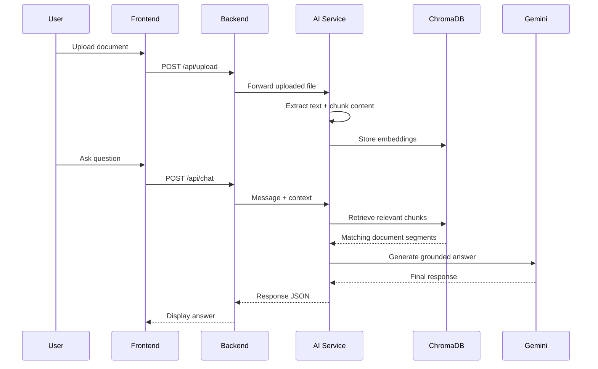

# 🤖 AI Document Assistant

<div align="center">


<p>
  A full-stack document Q&A application that lets users upload <strong>PDF</strong> and <strong>TXT</strong> files, extract the text, and ask natural-language questions through an AI-powered chat interface.
</p>

</div>

## ✨ Overview

AI Document Assistant is designed to make document interaction feel conversational. Instead of manually searching through long files, users can upload a document, let the AI process it, and then ask questions in plain English.

This project is currently a working local prototype connecting:

- a React frontend
- an Express backend
- a Python FastAPI AI service
- Google Gemini-powered answer generation
- ChromaDB-based retrieval for document search

## 🚀 Why it stands out

- Smart document upload and parsing
- Context-aware Q&A using RAG
- Clean chat-like user experience
- Local prototype built for rapid experimentation
- Easy to run and extend

## 🧠 How it works


## 🌟 Features

### Implemented

- React-based chat interface
- Express API server for frontend-to-AI communication
- Python FastAPI AI service
- Gemini integration for response generation
- PDF and TXT upload support
- Text extraction from uploaded documents
- RAG-style chunking and retrieval
- ChromaDB vector storage for embeddings
- API endpoints for chat and upload workflows

### Planned / Not yet implemented

- persistent chat history
- document management and listing
- user authentication and profiles
- advanced metadata indexing
- production deployment and hosting
- automated testing

## 🧩 Tech Stack

### Frontend

- React
- Vite
- JavaScript
- Tailwind CSS

### Backend

- Node.js
- Express.js
- CORS
- Multer
- dotenv

### AI Service

- Python
- FastAPI
- LangChain
- LangChain Google GenAI
- Google Gemini
- ChromaDB
- pypdf

## 📁 Project Structure

```text
AI-Document-Assistant/
├── .gitignore
├── README.md
├── backend/
│   ├── package-lock.json
│   ├── package.json
│   └── server.js
├── frontend/
│   └── react/
│       ├── index.html
│       ├── package.json
│       └── src/
│           ├── App.css
│           ├── App.jsx
│           ├── index.css
│           ├── main.jsx
│           └── components/
│               ├── ChatWindow.jsx
│               ├── Sidebar.jsx
│               └── UploadDocuments.jsx
└── ai-service/
    ├── chroma_db/
    ├── main.py
    ├── test_chunking.py
    ├── rag/
    │   ├── document_loader.py
    │   ├── embedding.py
    │   ├── retriver.py
    │   ├── text_splitter.py
    │   └── vector_store.py
    └── services/
        └── chat_service.py
```

## ⚙️ Getting Started

### Prerequisites

Make sure you have the following installed:

- Node.js 18+
- npm
- Python 3.11+
- Git
- Google Gemini API key

### 1) Clone the repository

```bash
git clone https://github.com/Sandeep405812/AI-Document-Assistant.git
cd AI-Document-Assistant
```

### 2) Start the backend

```bash
cd backend
npm install
npm start
```

The backend runs on port `5000` by default and proxies requests to the AI service.

### 3) Start the AI service

Open a second terminal:

```bash
cd ai-service
python -m venv .venv
source .venv/bin/activate
```

On Windows PowerShell:

```powershell
cd ai-service
python -m venv .venv
.\.venv\Scripts\Activate.ps1
```

Install the required Python packages:

```bash
pip install fastapi uvicorn python-dotenv langchain-google-genai langchain-chroma chromadb pypdf
```

Create a `.env` file inside `ai-service/`:

```env
GOOGLE_API_KEY=your_gemini_api_key
```

Then start the API:

```bash
python -m uvicorn main:app --reload --port 8000
```

The API docs are available at:

- http://127.0.0.1:8000/docs

### 4) Start the frontend

Open a third terminal:

```bash
cd frontend/react
npm install
npm run dev
```

Then open the local URL shown in the terminal.

## 🔌 API Endpoints

### Backend

- `POST /api/chat` — send a chat message to the AI service
- `POST /api/upload` — upload a PDF or TXT file for processing

Example request body for chat:

```json
{
  "message": "Summarize this document"
}
```

Example upload request:

- form field name: `myFile`
- allowed file types: `.pdf`, `.txt`

### AI Service

- `GET /` — health check
- `GET /chat?message=...` — simple chat endpoint
- `POST /api/chat` — JSON chat request for the document Q&A flow
- `POST /api/upload` — file upload endpoint that extracts text, splits it into chunks, and stores it in ChromaDB

## 🧠 Current AI workflow



## 🔐 Environment Variables

Keep secrets in local environment files and do not commit them to GitHub.

Required values:

```env
# ai-service/.env
GOOGLE_API_KEY=your_gemini_api_key
```

Optional backend config:

```env
# backend/.env
PORT=5000
```

## 🗺️ Roadmap

- [x] React chat interface
- [x] Express backend API
- [x] FastAPI AI service
- [x] Gemini AI integration
- [x] PDF/TXT upload support
- [x] Document text extraction
- [x] ChromaDB vector storage setup
- [x] RAG-style document chunking and retrieval
- [ ] Persistent chat history
- [ ] Document management and listing
- [ ] User authentication
- [ ] Testing and deployment

## 📌 Notes

This project is a local, prototype-level implementation. It currently focuses on the core document Q&A workflow and is not yet production-ready for multi-user deployment, persistent storage, or authentication-heavy environments.

## 👨‍💻 Author

**Sandeep Singh**

GitHub: [Sandeep405812](https://github.com/Sandeep405812)

---

<div align="center">
  <strong>🚀 This project is under active development.</strong>
</div>
